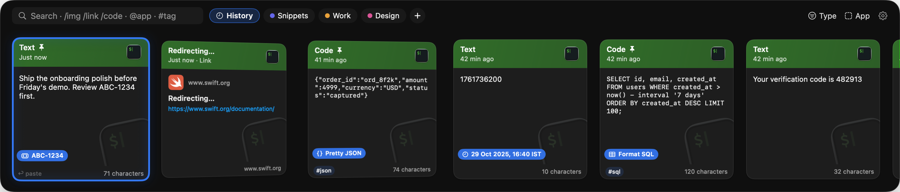
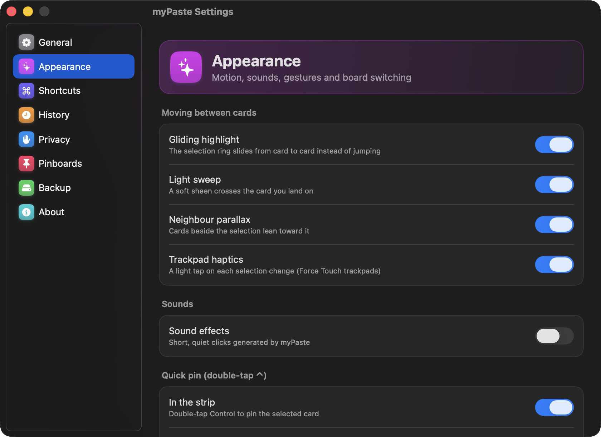

# myPaste

A clipboard manager for the Mac that keeps everything you copy one keystroke away.

I loved Paste but didn't need sync, an account or a subscription, so I built my own. Everything stays on
your Mac.



## What it does

Press **⇧⌘C** and your recent copies slide up as cards. Pick one and it's pasted where you were typing.

- **Remembers everything:** text, links (with previews), images (searchable, even the text inside them), files, colours and code.
- **Sorts itself:** every copy is labelled by type, and you can filter by type, app or tag.
- **Pinboards:** keep the things you reuse, like addresses, snippets and queries, on boards of your own.
- **Finds anything:** search across your history and every board at once.
- **Keeps secrets quiet:** OTPs, API keys and ID numbers are masked and cleared after a few minutes.
- **Small conveniences:** format JSON or SQL, clean up URLs and convert timestamps with ⌘K.

Hold **⌘** while the strip is open to see every shortcut. The full list is in [docs/SHORTCUTS.md](docs/SHORTCUTS.md).



## Install

You need macOS 14 or later and Apple's Command Line Tools (`xcode-select --install`). You don't need Xcode.

```
git clone https://github.com/Navdevl/myPaste.git
cd myPaste
make cert
make install
```

`make cert` creates a signing certificate on your Mac (it never leaves it), so the permission below survives
future updates. `make install` builds the app into `~/Applications` and opens it.

On first launch, myPaste asks for **Accessibility** access. That's how it pastes into the app you were using.
Without it, picking a card just copies it.

To uninstall, quit myPaste and delete `~/Applications/myPaste.app` and
`~/Library/Application Support/myPaste`.

## Contributing

Ideas and pull requests are welcome. [docs/DEVELOPMENT.md](docs/DEVELOPMENT.md) covers building, tests and how
the code is laid out.

## License

MIT, see [LICENSE](LICENSE). You're free to use, change and share it, including commercially. Just keep the
copyright notice, and a link back to this repo is appreciated.

Built with [GRDB](https://github.com/groue/GRDB.swift) and
[KeyboardShortcuts](https://github.com/sindresorhus/KeyboardShortcuts). Not affiliated with Paste or Maccy.
